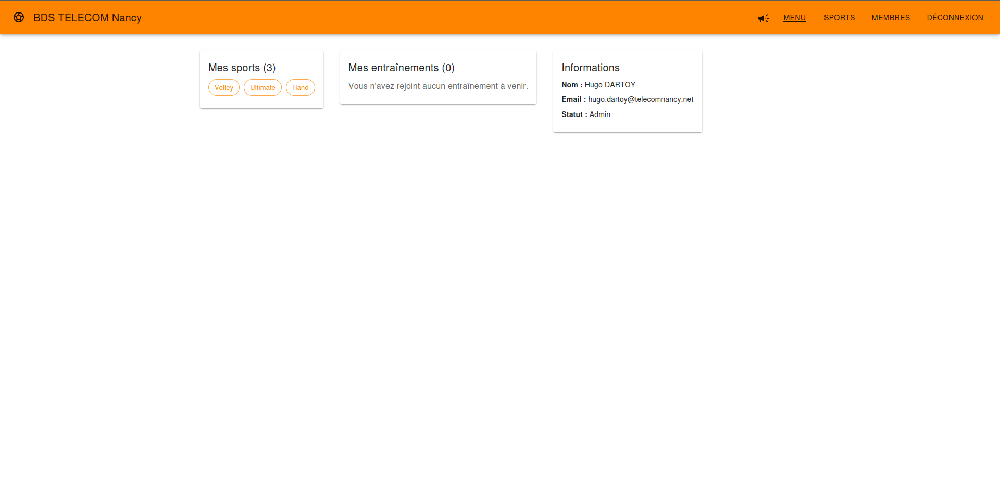
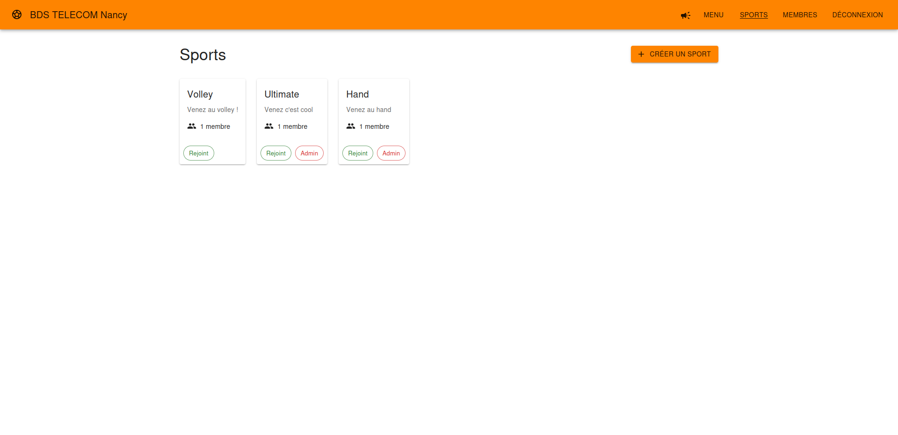
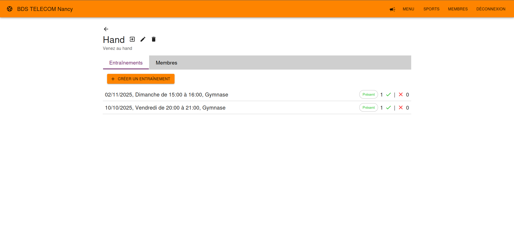
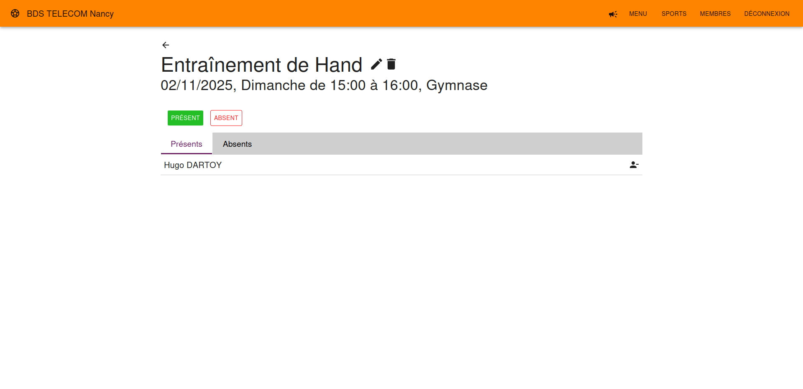
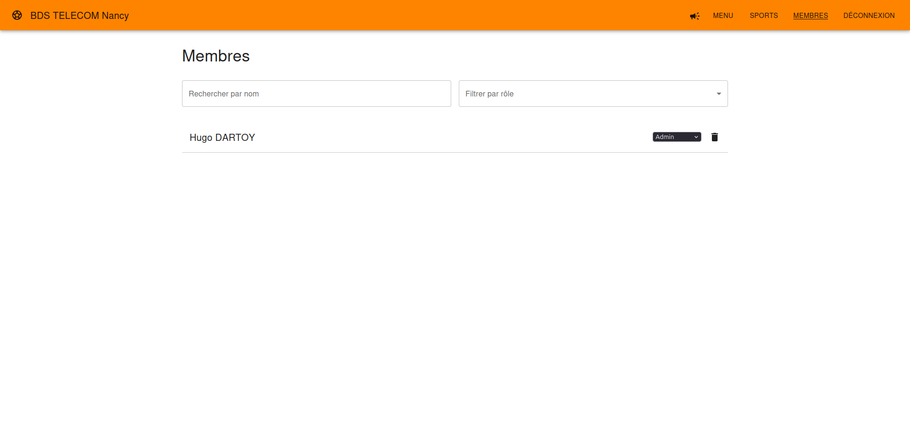

# OpenSport - Sport Association Management System

A web application for sport associations built with Go backend, MongoDB database, and React frontend.

## Features

- **User Authentication**: Register and login system
- **Sport Management**: Users can join different sports, admins can manage sports
- **Training Management**: Sport admins can create trainings, users can join them
- **Dashboard**: Overview of user's sports and trainings
- **Role-based Access**: Different permissions for regular users and sport admins

## Presentation

**Home page**



**Sports list**



**Sport page**



**Training**



**Members**




## Technology Stack

- **Backend**: Go with Gin framework
- **Database**: MongoDB
- **Frontend**: React with Material-UI
- **Authentication**: JWT tokens
- **Containerization**: Docker and Docker Compose

## Quick Start

### Using Docker Compose (Recommended)

1. Clone the repository:
```bash
git clone <repository-url>
cd OpenSportTest
```

2. Create environment file:
```bash
cp .env.example .env
```

3. Start all services:
```bash
docker-compose up -d
```

4. Access the application:
- Frontend: http://localhost:3000
- Backend API: http://localhost:8080
- MongoDB: localhost:27017

### Manual Setup

#### Prerequisites
- Go 1.24+
- Node.js 20+
- MongoDB

#### Backend Setup
```bash
cd backend
go mod tidy
go run cmd/main.go
```

#### Frontend Setup
```bash
cd frontend
npm install
npm run dev
```

## API Endpoints

### Authentication
- `POST /api/auth/register` - Register new user
- `POST /api/auth/login` - Login user

### Protected Routes
- `GET /api/profile` - Get user profile
- `GET /api/user/sports` - Get user's sports
- `GET /api/user/trainings` - Get user's trainings

### Sports
- `GET /api/sports` - Get all sports
- `POST /api/sports` - Create new sport (requires authentication)
- `POST /api/sports/:id/join` - Join a sport

### Trainings
- `GET /api/trainings` - Get all trainings
- `POST /api/trainings` - Create new training (requires sport admin)
- `POST /api/trainings/:id/join` - Join a training

## Project Structure

```
├── backend/
│   ├── cmd/                 # Application entrypoints
│   ├── internal/
│   │   ├── api/            # HTTP handlers
│   │   ├── auth/           # Authentication logic
│   │   ├── database/       # Database connection
│   │   └── models/         # Data models
│   └── Dockerfile
├── frontend/
│   ├── src/
│   │   ├── components/     # React components
│   │   ├── contexts/       # React contexts
│   │   └── App.jsx
│   ├── Dockerfile
│   └── nginx.conf
├── docker-compose.yml
└── README.md
```

## Usage

1. **Register**: Create a new account or login with existing credentials
2. **Join Sports**: Browse available sports and join ones you're interested in
3. **Create Sports**: Any user can create new sports (automatically becomes admin)
4. **Manage Trainings**: Sport admins can create trainings for their sports
5. **Join Trainings**: Users can join trainings for sports they're members of

## Environment Variables

See `.env.example` for all available environment variables.

## Development

### Running Tests
```bash
# Backend tests
cd backend && go test ./...

# Frontend tests
cd frontend && npm test
```

### Building for Production
```bash
# Backend
cd backend && go build -o opensport cmd/main.go

# Frontend
cd frontend && npm run build
```

## Contributing

1. Fork the repository
2. Create a feature branch
3. Make your changes
4. Add tests if applicable
5. Submit a pull request

## License

This project is open source and available under the [MIT License](LICENSE).